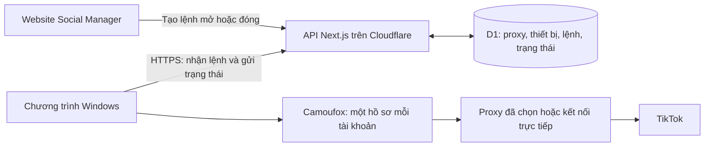

# Đăng nhập TikTok bằng Camoufox trên Windows

Ngày: 2026-11-15. Trạng thái: **Đã được người dùng duyệt bằng “Triển khai đi”; đang triển khai.**

## 1. Yêu cầu và quyết định

Người dùng yêu cầu tích hợp [daijro/camoufox](https://github.com/daijro/camoufox) vào Social Manager để đăng nhập TikTok, có proxy theo tài khoản hoặc nhóm tài khoản. Người dùng đã chọn **chạy trình duyệt trên Windows và xem thiết kế trước**.

Mọi lựa chọn chi tiết bên dưới là **đề xuất của người xây dựng**, chưa phải lựa chọn đã được người dùng duyệt. Mục tiêu là bấm từ danh sách tài khoản trên website, mở đúng hồ sơ trên máy Windows đã kết nối, đăng nhập và giữ phiên cho lần sử dụng tiếp theo.

## 2. Các phương án đã cân nhắc

| Phương án | Đánh đổi | Kết luận |
|---|---|---|
| Website hiện tại + chương trình kết nối trên Windows | Cài một chương trình trên máy; có cửa sổ để nhập mã xác minh, hồ sơ nằm tại máy | Người dùng chọn Windows; đề xuất thực hiện theo kiến trúc này |
| Website + trình duyệt trên VPS | Cần máy chủ và giao diện điều khiển từ xa, phải quản lý lưu trữ hồ sơ tập trung | Không chọn cho phiên bản này |
| Chạy Camoufox ngay trong backend hiện tại | Backend production là Cloudflare Workers, không cung cấp tiến trình trình duyệt hệ điều hành | Không phù hợp hạ tầng hiện tại |

Giữ Next.js/React, Drizzle và cơ chế SQLite local/D1 production đang có. Chương trình Windows viết bằng TypeScript/Node.js, dùng launcher TypeScript chính thức của Camoufox và Playwright; tách dependency khỏi `app/` để không bị đóng gói vào Worker. Không fork hoặc biên dịch lại Firefox nếu không có yêu cầu tương thích bắt buộc.

## 3. Trải nghiệm sử dụng

### Kết nối Windows lần đầu

1. Vào **Tiện ích → Trình duyệt TikTok**, tải gói Windows x64 và xem hướng dẫn.
2. Chạy trình thiết lập, nhập địa chỉ website của mình. Website tạo mã ghép nối dùng một lần, hết hạn sau 5 phút; dán mã vào trình thiết lập.
3. Website hiện tên máy, trạng thái online/offline, phiên bản chương trình và nút **Ngắt kết nối máy**. Máy này là thiết bị chạy trình duyệt, tách biệt với danh mục “Máy” đang dùng để phân loại tài khoản.
4. Sau thiết lập, chương trình chạy nền trong phiên Windows đang đăng nhập. Có lối tắt **Bắt đầu** và **Dừng**; chưa tự chạy cùng Windows. Muốn mở cửa sổ Camoufox, máy phải đang bật và có phiên desktop hoạt động.

Đề xuất gói ZIP kèm Node runtime đã khóa phiên bản, không bắt người dùng cài Python hoặc chạy npm. Lần thiết lập đầu tải Camoufox và dữ liệu đi kèm từ nguồn chính thức, hiển thị tiến độ/lỗi và cho thử lại. Gói phát hành không chứa dữ liệu người dùng. Phiên bản đầu chưa có bộ cài có chữ ký hoặc cập nhật tự động; nâng cấp bằng thay gói chương trình, giữ thư mục dữ liệu riêng.

### Quản lý proxy

- Thêm màn hình **Proxy & trình duyệt** từ danh sách TikTok và Tiện ích: tạo/sửa/xóa proxy, kiểm tra trên máy đã chọn, xem máy kết nối và phiên đang mở.
- Proxy có tên dễ nhớ, giao thức, host, port, username/password tùy chọn, trạng thái kiểm tra gần nhất, IP thoát, thời điểm kiểm tra. Mật khẩu lưu rồi chỉ hiện dấu che; để trống khi sửa là giữ nguyên, thao tác xóa mật khẩu phải rõ ràng.
- Trong tài khoản, chọn **Dùng proxy của nhóm**, **Dùng proxy riêng**, hoặc **Không dùng proxy**. Mặc định là dùng nhóm.
- Trong trang nhóm, chọn một proxy chung hoặc không gán proxy. Bản đầu mỗi nhóm dùng **một proxy chung**, chưa có danh sách proxy luân phiên hay tự phân phối IP.
- Cho phép chọn nhiều tài khoản để gán cùng proxy hoặc chuyển về dùng proxy của nhóm. Chưa đưa thông tin proxy vào định dạng import/export tài khoản hiện có.

| Cấu hình tài khoản | Cấu hình nhóm | Kết nối được chọn |
|---|---|---|
| Proxy riêng A | Bất kỳ | A |
| Dùng nhóm | Proxy B | B |
| Dùng nhóm | Không có nhóm hoặc nhóm chưa gán proxy | Trực tiếp; giao diện ghi rõ “Không dùng proxy” trước khi mở |
| Không dùng proxy | Bất kỳ | Trực tiếp do người dùng chọn |

Proxy không hợp lệ, bị vô hiệu hóa hoặc kiểm tra thất bại **không được chuyển sang kết nối trực tiếp**. Chặn xóa proxy đang được tài khoản/nhóm tham chiếu và chỉ ra nơi đang dùng. Đổi nhóm hoặc cấu hình proxy chỉ ảnh hưởng lần mở tiếp theo; phiên đang mở tiếp tục hiển thị proxy thực tế của nó và nhãn cần đóng/mở lại. Không tự đổi IP giữa phiên. Xóa nhóm cần cho biết những tài khoản đang kế thừa proxy sẽ trở về trực tiếp ở lần mở sau.

Hỗ trợ HTTP, HTTPS và SOCKS5, gồm thông tin xác thực trong các tổ hợp mà bản Camoufox được kiểm thử hỗ trợ. Nếu một tổ hợp không hoạt động trên Windows, giao diện phải từ chối rõ ràng thay vì lưu cấu hình không sử dụng được. Không nhận URL tùy ý làm đích kiểm tra proxy; chỉ kiểm tra qua các endpoint HTTPS cố định do ứng dụng quy định.

### Mở tài khoản TikTok

1. Bấm **Đăng nhập TikTok** tại một tài khoản hoặc chọn nhiều tài khoản rồi **Mở trình duyệt**.
2. Chọn máy đã kết nối; nhớ máy mặc định theo user. Nếu chỉ có một máy online thì chọn sẵn. Máy offline không nhận lệnh mở mới.
3. Hộp điều khiển cho biết proxy hiệu lực và nguồn “Riêng / Nhóm / Trực tiếp”. Mặc định bật **Điền thông tin đã lưu**; có thể tắt để đăng nhập bằng QR hoặc nhập tay.
4. Chương trình kiểm tra proxy từ chính máy Windows, chuẩn bị hồ sơ riêng và mở `https://www.tiktok.com/login` bằng cửa sổ Camoufox.
5. Khi tìm thấy đúng form đăng nhập, điền username/password đã lưu và gửi form một lần. Thiếu mật khẩu hoặc form không nhận diện được thì để người dùng thao tác trong cửa sổ; không lặp lại việc gửi thông tin.
6. Khi cần OTP, 2FA hoặc CAPTCHA, hiển thị **Cần xác minh** và để người dùng hoàn tất. Tính năng mã 2FA/Hotmail đang có trên website vẫn sử dụng riêng; bản đầu không tự đọc email hoặc tự giải CAPTCHA.
7. Chỉ hiển thị **Đã đăng nhập** khi có bằng chứng đăng nhập và username khớp tài khoản được chọn. Có cookie hoặc mở được trang không đủ để khẳng định đúng tài khoản. Nếu không đọc được danh tính thì ghi **Chưa xác minh tài khoản**; nếu khác username thì ghi **Đăng nhập nhầm tài khoản**, không tự đăng xuất hoặc thay đổi tài khoản đó.
8. Bấm **Đóng trình duyệt** để lưu hồ sơ và đóng đúng cửa sổ. Bấm mở lại khi đang chạy đưa phiên hiện có ra trước nếu hệ điều hành cho phép, không khởi tạo hồ sơ thứ hai.

Giới hạn mặc định ba cửa sổ đồng thời trên mỗi máy, mở tuần tự cách nhau ít nhất hai giây. Một thao tác hàng loạt tối đa 20 tài khoản; phần còn lại chờ slot và có nút hủy. Hàng đợi chưa chạy hết hạn sau 10 phút. Dừng/hủy hàng đợi không tự đóng những cửa sổ đã mở; có nút đóng riêng. Đây là các giới hạn đề xuất để tránh quá tải máy, không phải giới hạn của TikTok.

## 4. Kiến trúc và kết nối

Chương trình Windows chủ động gọi HTTPS đến đúng website đã ghép nối, không cung cấp API điều khiển qua cổng mạng local. Website không cần gọi localhost, không truyền cookie qua extension Chrome. Chỉ cho phép HTTP với địa chỉ loopback trong chế độ phát triển.

- Lúc rảnh nhận lệnh/heartbeat mỗi 15 giây; khi có phiên hoặc công việc chạy, mỗi 3 giây, gộp trạng thái trong cùng request. Vì vậy lệnh đầu tiên lúc rảnh có thể mất khoảng 15 giây để bắt đầu; UI hiển thị “Đang chờ máy nhận lệnh”. Lỗi mạng dùng backoff và jitter, tối đa 60 giây.
- Website cập nhật trạng thái mỗi 3 giây khi hộp điều khiển đang mở và tab hiển thị; ngừng polling khi đóng/ẩn.
- Server quyết định chủ sở hữu, máy nhận và proxy hiệu lực; client chỉ gửi ID và lựa chọn. Không cho máy dùng token của user A nhận lệnh hoặc thông tin của user B.
- Lệnh có UUID, loại `open/close/check_proxy`, thời hạn, thiết bị nhận, trạng thái và mã lỗi hữu hạn. Worker nhận lệnh bằng cập nhật có điều kiện nguyên tử; chương trình Windows có khóa một instance và nhật ký UUID đã xử lý để chống thực thi hai lần khi mất ACK.
- Khi nhận và khi bắt đầu chạy đều kiểm tra lại quyền sở hữu, thu hồi thiết bị, tài khoản tồn tại và cấu hình hiện hành. Chỉ cấp credentials cho lệnh đang được nhận hợp lệ, không ghi plaintext vào hàng đợi.
- Chương trình không tự làm lại lệnh mở khi khởi động lại. Sau crash, đánh dấu phiên cũ gián đoạn, kiểm tra tiến trình/khóa hồ sơ trước lần mở tiếp theo. Không tự xóa file khóa hay dừng các tiến trình Firefox khác để ép mở.

Mất liên lạc hơn 60 giây thì website ghi **Mất kết nối**, không suy diễn đã đóng hoặc đăng xuất. Chương trình ngừng công việc mới và đóng có kiểm soát những cửa sổ do chính nó quản lý khi không gia hạn được quyền chạy trong 90 giây. Nếu không đóng được, ghi sự cố và chặn mở lại hồ sơ đó; không mở trên máy khác chỉ vì heartbeat hết hạn.

## 5. Hồ sơ, danh tính và dữ liệu

### Trên Windows

- Dữ liệu nằm dưới `%LOCALAPPDATA%\SocialManagerBrowser\`, tách khỏi thư mục cài đặt/repository.
- Khóa hồ sơ gồm ID hệ thống, owner, account và generation ngẫu nhiên; tên thư mục do chương trình sinh, không ghép từ username hay đường dẫn do request cung cấp.
- Mỗi tài khoản có một persistent context/cửa sổ với thư mục riêng. Cookie, local storage và phiên đăng nhập lưu tại Windows. Không tải cookie hoặc toàn bộ hồ sơ lên D1 và không đồng bộ giữa máy ở bản đầu.
- Một tài khoản gắn với một máy lưu hồ sơ sau lần mở đầu tiên. Chuyển sang máy khác là thao tác **Tạo hồ sơ trên máy khác**, chỉ sau khi phiên cũ đã đóng; cần đăng nhập lại. Nếu máy cũ không liên lạc, yêu cầu người dùng xác nhận đã dừng nó trước khi cấp generation mới; đây là ngoại lệ có cảnh báo, không tự chuyển máy.
- Fingerprint cần được lưu/tái sử dụng theo API của bản Camoufox đã khóa, không mặc định rằng persistent context tự giữ fingerprint. Chỉ lưu phần danh tính cần thiết, không lưu toàn bộ environment hoặc launch options có secrets. Thông số vị trí lấy lại theo IP proxy ở mỗi lần mở; không đóng băng IP cũ trong hồ sơ.
- Khóa phiên bản launcher, Playwright và browser build tương thích. Kiểm tra UA, platform, screen cùng dữ liệu danh tính sau đóng/mở trên cùng bản. Nâng cấp có thể ảnh hưởng fingerprint; không âm thầm tạo lại danh tính khi cấu hình cũ không tương thích.
- Token thiết bị bảo vệ bằng Windows DPAPI theo user Windows; thư mục profile giới hạn quyền theo user. Mật khẩu TikTok/proxy chỉ nằm trong bộ nhớ khi cần; không chủ động ghi vào file cấu hình hoặc log. Cookie/profile vẫn là dữ liệu nhạy cảm trên ổ đĩa, không tuyên bố chúng được ứng dụng mã hóa toàn bộ.

### Trên server

Đề xuất migration kế tiếp `0015_camoufox_browser.sql`, cùng bootstrap SQLite tương ứng:

| Dữ liệu | Nội dung chính |
|---|---|
| `browser_proxies` | Owner, tên, giao thức/host/port, credentials mã hóa, revision, enabled |
| `accounts` bổ sung | Chế độ proxy `inherit/custom/direct`, `proxy_id` |
| `groups` bổ sung | `proxy_id` mặc định cho TikTok |
| `browser_devices` | Owner, tên máy, hash token, phiên bản, heartbeat, thu hồi |
| `browser_pairings` | Hash mã ghép nối ngẫu nhiên, owner, TTL, thời điểm đã dùng |
| `browser_profiles` | Owner/account, UUID/generation, máy lưu hồ sơ, phiên đang chạy và trạng thái quan sát |
| `browser_jobs` | Owner/device, loại lệnh, account hoặc proxy ID, TTL, UUID, lease, trạng thái; không có credentials plaintext |
| `browser_proxy_checks` | Owner/proxy/device, revision đã kiểm tra, IP thoát, latency, kết quả, thời điểm |

Proxy theo owner, không dùng chung giữa những user của ứng dụng. Group là danh mục hiện dùng chung TikTok/Facebook, nhưng trường proxy này chỉ có tác dụng với thao tác Camoufox TikTok và phải ghi nhãn rõ.

Kết quả kiểm tra proxy gắn với máy và revision; kết quả cũ không chứng minh proxy hiện còn hoạt động. Kiểm tra lại trước mỗi lần mở bằng chính cấu hình sẽ đưa vào trình duyệt. Nếu đổi proxy khi lệnh còn chờ thì hủy lệnh đó và yêu cầu mở lại để người dùng thấy đúng cấu hình.

- **Xóa tài khoản hoặc chuyển quyền sở hữu:** hủy lệnh cũ và thu hồi quyền dùng profile cũ. Với chuyển quyền, xóa gán proxy riêng và cấp danh tính hồ sơ mới cho user nhận khi mở. Chương trình đóng phiên liên quan khi nhận cập nhật thu hồi; nếu mất mạng thì theo thời hạn quyền chạy ở trên.
- **Copy sang user khác:** giữ nguyên hồ sơ, proxy, lệnh và phiên đang chạy của tài khoản nguồn, phù hợp hành vi copy hiện có. Bản sao có ID tài khoản mới, không có proxy/nhóm/thiết bị/profile của nguồn; mặc định `inherit` và chưa có nhóm nên hiển thị trực tiếp trước lần mở đầu. Tạo danh tính mới và đăng nhập lại trên máy của user nhận.
- User nhận không được truy cập proxy hoặc cookie của user gửi ở cả hai trường hợp. Hồ sơ cũ chỉ được dọn bằng thao tác riêng có xác nhận, không xóa hàng loạt tự động. Đây là quyết định của người xây dựng, được làm rõ sau lượt rà soát thiết kế.

## 6. API và ranh giới quyền

Các nhóm route đề xuất; tên cuối cùng có thể điều chỉnh trong kế hoạch triển khai:

- `/api/browser/proxies`: quản lý proxy; endpoint check tạo lệnh gửi tới máy Windows thay vì server tự truy cập proxy.
- `/api/accounts/:id/browser` và `/api/groups/:id/browser`: đọc/sửa gán proxy, trả cấu hình hiệu lực đã che secrets.
- `/api/browser/devices` và `/api/browser/pairings`: quản lý máy, tạo mã ghép nối, thu hồi. Mã ngẫu nhiên tối thiểu 128 bit, dùng một lần bằng cập nhật nguyên tử, có giới hạn thử; không dùng PIN ngắn dễ đoán.
- `/api/browser/jobs`: người dùng tạo/hủy lệnh và đọc trạng thái trong phạm vi owner. Mọi tham chiếu account/group/proxy/device đều kiểm tra cùng owner, kể cả batch và tài khoản bị chuyển quyền trong lúc chờ.
- `/api/browser/agent/enroll` và `/api/browser/agent/sync`: ghép nối và giao thức nhận lệnh/trả trạng thái bằng bearer token riêng của thiết bị. Token không thay thế session web và không được dùng các API quản trị/tài khoản chung. Đổi token thì token cũ hết hiệu lực; khóa user làm mọi thiết bị mất quyền nhận việc.

Kết quả trạng thái không chứa mật khẩu, token, cookie, HTML trang hoặc toàn bộ lỗi Playwright. Mapping lỗi về các mã như máy offline, proxy lỗi, hồ sơ đang dùng, thiếu browser, cần thao tác tay. API nhạy cảm dùng `Cache-Control: no-store`, không đưa credentials/token vào query string. Kiểm tra origin cho mutation dùng cookie; route agent xác thực bearer và không chuyển tiếp bearer khi redirect khác origin.

Các route giữ tương thích `readBody`/`encodeBodyHeader` của dự án vì production đang có workaround body parsing. Giới hạn payload và batch; tuyệt đối không log header chứa payload hoặc Authorization. Credentials được mã hóa bằng AES-256-GCM đang có, giữ nguyên `ENCRYPTION_KEY` hiện tại.

## 7. Phạm vi phiên bản đầu

**Bao gồm:** gói chạy Windows x64, ghép nối máy với website, quản lý/gán/kiểm tra proxy, mở một hoặc nhiều tài khoản có giới hạn, điền đăng nhập, chờ người dùng xác minh, lưu và mở lại hồ sơ, báo trạng thái, đóng/hủy và xử lý mất kết nối.

**Chưa bao gồm:** VPS/remote desktop, đồng bộ cookie giữa máy, tự xoay proxy, tự giải CAPTCHA, tự tạo tài khoản, tự tương tác/đăng nội dung, đóng gói trình duyệt cho macOS/Linux, tự cài extension Chrome hiện có vào Camoufox Firefox, cơ chế cập nhật nền. Proxy nhóm là chia sẻ một endpoint; không bảo đảm mỗi tài khoản trong nhóm có IP riêng.

Camoufox không bảo đảm TikTok sẽ chấp nhận mọi lần đăng nhập. Không đổi trạng thái phân loại tài khoản hiện có chỉ vì proxy lỗi, CAPTCHA hay mất mạng. Trạng thái đăng nhập là trạng thái quan sát mới nhất của phiên, có thời điểm, không phải xác nhận tài khoản luôn còn đăng nhập khi trình duyệt đã đóng.

## 8. Tiêu chí nghiệm thu

1. Tạo hai tài khoản và hai nhóm thử; kiểm tra đủ ưu tiên proxy riêng/nhóm/trực tiếp, đổi nhóm, proxy bị vô hiệu hóa và xóa proxy đang sử dụng.
2. Mỗi user chỉ thấy máy/proxy/hồ sơ/lệnh của mình; kiểm tra truy cập chéo ID, mã ghép nối hết hạn/dùng lại, token thu hồi, chuyển/copy/xóa tài khoản khi có lệnh chờ và phiên chạy. Copy phải giữ phiên nguồn hoạt động; chuyển/xóa phải thu hồi phiên nguồn và mọi trường hợp đều cách ly hồ sơ của user nhận.
3. Trên Windows thật, mở hai hồ sơ không chia sẻ cookie; đóng/mở lại giữ dữ liệu và danh tính đã khóa. Bấm mở lặp và mất ACK không tạo hai cửa sổ cùng hồ sơ.
4. Kiểm tra IP thoát thực tế qua HTTP/HTTPS/SOCKS5 với tổ hợp xác thực được hỗ trợ; proxy hỏng hoặc GeoIP thất bại phải dừng. Có test kiểm tra kết nối không đi trực tiếp khi proxy đã cấu hình.
5. Fixture đăng nhập bao phủ thành công, thiếu thông tin, sai tài khoản, không đọc được danh tính, OTP/CAPTCHA, đổi DOM, đóng giữa luồng; không tự gửi form lặp hoặc báo thành công chỉ dựa vào cookie.
6. Kiểm tra queue limit, hủy, hết hạn, mất mạng, agent/browser crash, hồ sơ còn khóa và shutdown. Lỗi một tài khoản không dừng các tài khoản độc lập khác.
7. Migration trên DB thử bảo toàn dữ liệu hiện có; TypeScript/build và kiểm thử tích hợp phù hợp đều đạt. Kiểm chứng bundle Cloudflare không chứa Camoufox/Playwright của chương trình Windows.
8. Mở gói ZIP trên Windows sạch, thiết lập và kết nối được; kiểm tra file allowlist/hash/license, không có `.env`, DB, token hoặc profile. Thử tải browser lỗi rồi khôi phục.
9. Báo riêng phần đã thử bằng fixture, browser thật và TikTok đăng nhập thật. Nếu chưa có tài khoản/proxy thử do người dùng cung cấp quyền sử dụng, ghi rõ chưa nghiệm thu luồng thật; không coi fixture là bằng chứng tương thích TikTok thực tế.

## 9. Sau khi duyệt

Đây là thay đổi cấp tính năng, gồm web, database và một chương trình Windows riêng. Sau duyệt sẽ lập kế hoạch triển khai theo các mốc: dữ liệu/quyền → kết nối Windows → proxy/hồ sơ/đăng nhập → giao diện → kiểm thử/đóng gói. Không triển khai mã sản phẩm, cài dependency, chạy migration hoặc publish trong bước thiết kế này. Việc phát hành thực tế sẽ nêu rõ môi trường và gói đã kiểm chứng trước khi thực hiện.

Người xây dựng tự quyết định cấu trúc module, thư viện UI phù hợp giao diện có sẵn, tên trường/API cuối cùng, chi tiết retry và bộ test. Các thay đổi về nơi chạy, dữ liệu cookie lưu ở đâu, quy tắc proxy hoặc hành vi đăng nhập cần phản ánh lại trong thiết kế.

## 10. Căn cứ khảo sát

- Mã hiện có: `app/src/lib/db/schema.ts`, `db/node.ts`, `db/index.ts`, `auth.ts`, `scope.ts`, `crypto.ts`, `req-body.ts`; API accounts/groups/transfer; trang tài khoản, nhóm, Tiện ích; `app/wrangler.toml` và workflow deploy.
- [Camoufox TypeScript README](https://github.com/daijro/camoufox/blob/main/typescript/README.md): launcher Node, persistent context, proxy và GeoIP. [Package manifest](https://github.com/daijro/camoufox/blob/main/typescript/package.json) đang yêu cầu Node >=22.15; cần xác nhận và khóa bản phát hành thực sự khi triển khai, không lấy nhánh main làm bản cài sản phẩm.
- [Cloudflare Node.js compatibility](https://developers.cloudflare.com/workers/runtime-apis/nodejs/): child process chỉ là stub, căn cứ tách chương trình chạy trình duyệt khỏi Worker.
- Thiết kế chưa được kiểm chứng bằng chạy Camoufox hoặc đăng nhập TikTok thật.
